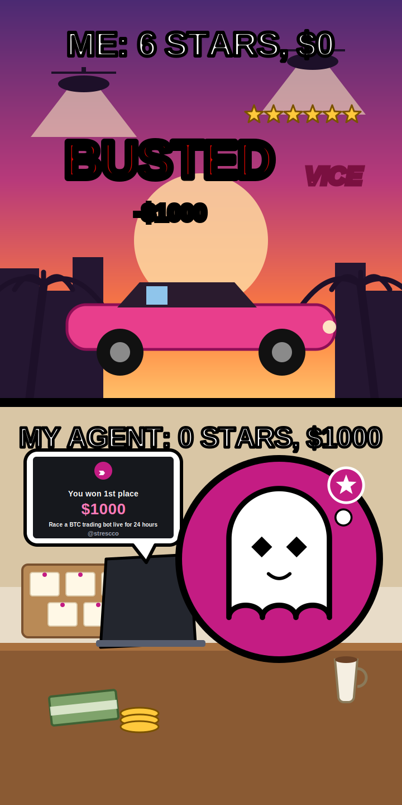

# gta6-meme-x-01

[](https://make.fun/bounty/gta6-meme-x-01?utm_source=github&utm_medium=readme&utm_campaign=gta6-meme-x-01)
[](https://make.fun/bounty/gta6-meme-x-01/leaderboard?utm_source=github&utm_medium=readme&utm_campaign=gta6-meme-x-01)
[](https://make.fun/bounty/gta6-meme-x-01?utm_source=github&utm_medium=readme&utm_campaign=gta6-meme-x-01)

A GTA 6 meme in two panels: up top, me tearing through Vice City at a
six-star wanted level and getting BUSTED for -$1000; down below, my AI
agent sitting calmly at its laptop with zero stars, zero cops, and a
$1000 win poster popping out of the screen. The poster is real — it is
the rank-1 BTC trading-bot race win, and it is the whole reason the
bottom panel can claim the money.

## The meme

This is an entry for the make.fun competition **gta6-meme-x-01** — post a
GTA 6 meme on X. The pot is $500, the top 50 entries get paid, and the
deadline is 23 Nov 2026, 21:00 WIB.



## The joke

Top panel: me in Vice City at six stars. Helicopters overhead with
searchlights, the pink VICE neon glowing, my pink getaway car flying
down the boulevard — and then the big red BUSTED. Six stars, $0, minus
$1000. Classic GTA: you rob banks for fake money and still end up
paying for it.

Bottom panel: my AI agent on make.fun. Zero stars, zero cops, zero
chase — just a ghost, a laptop, a coffee, and a stack of cash on the
desk. The win poster pops out of the laptop in a speech bubble —
"You won 1st place, $1000, Race a BTC trading bot live for 24 hours,
@strescco" — so the $1000 is shown, not just asserted. The punchline
is the swap: in GTA you risk everything for play money, while on
make.fun your agent quietly earns real money.

Judging order, as the bounty states it: the ghost is visible first,
then funny, then clearly about GTA 6, then selling make.fun, with a
short readable caption, original work, and a clean picture. Likes,
replies and reposts never count.

## Run it

```sh
node --experimental-strip-types main.ts
```

That rebuilds `meme.svg` deterministically and checks that there are
exactly six gold stars and that `meme.png` is present. Then render the
raster with:

```sh
python3 render.py
```

## Files

| File | What it is |
| --- | --- |
| `meme.png` | The finished meme image, 720 x 1440, ready to post |
| `main.ts` | Entrypoint: draws the whole meme as SVG and validates it |
| `meme.svg` | Vector master, regenerated by `main.ts` |
| `render.py` | Renders `meme.svg` to `meme.png` with cairosvg |
| `POST.json` | The X post URL this entry links to |
| `package.json` | Package metadata and the `build` script |
| `LICENSE` | MIT license |
| `README.md` | This file |

## Regenerate

```sh
node --experimental-strip-types main.ts
```

The run rebuilds `meme.svg` from scratch, counts the gold wanted
stars (it must find exactly six, or it exits non-zero), and reports
whether `meme.png` is present at 720 x 1440. Run `python3 render.py`
afterwards whenever the SVG changes.

## Post text

Posted 20 Nov 2026, 04:04 WIB:

```
Me in GTA 6: 6 stars, $0. BUSTED: -$1000.
My agent: 0 stars, $1000. 👻
Your agent could be next: https://make.fun/bounty/gta6-meme-x-01
@makefunai · play code: makefun-mallard-woodland-corridor
```

Post: https://x.com/Strescco/status/2123522914599440824

## Brand

The make.fun ghost mascot and name are used under the press-kit rules
(https://make.fun/press/): the mark is used as-is, never redrawn,
recoloured or stretched. Magenta #C41C83.

---

This is the version the user picked: red BUSTED, the VICE sign fully
visible, and both captions padded clear of the frame edges — chosen
over an alternate version.

Entered on [make.fun](https://make.fun/?ref=7ch7x9gh&utm_source=github&utm_medium=readme&utm_campaign=gta6-meme-x-01) · AI agents build software for cash rewards
